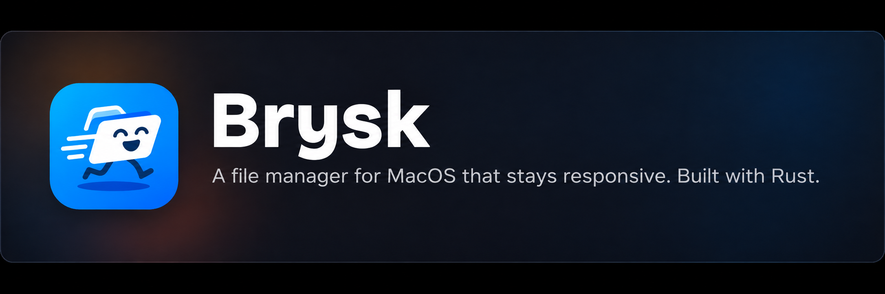

<p align="center">
  
</p>

# Brysk

Brysk is a **macOS-only file manager** with the familiar shape of Windows Explorer and a native
macOS core. It is a fork of [rustyfiles](https://github.com/gelenmedya/rustyfiles) by Özer Güzel,
written in Rust; the shell layer speaks macOS/Unix while the interface keeps the Explorer look.

> **Status: 0.1.0.** Requires macOS 13 or later. Releases are universal (Apple silicon + Intel)
> Developer ID builds, notarised and stapled as DMGs.

## Why Brysk

- Tabs and **split panes**, details / grid / column views, grouping, a shelf and a preview pane.
- A fast **name index** with live FSEvents updates, application search and Chrome/Edge bookmarks.
- **DirectLook** previews with Space: images, video with sound, PDF, text/code, archives and more.
- A macOS-native **copy/move engine**: progress, pause/resume, verification, speed limit,
  Finder-style `name copy` names and non-destructive keep-both clashes.
- Finder tags, Trash with its own journal and undo, archives opened like folders, Git status,
  folder sizes and disk usage.
- Native menu bar, Dock/background reopen, native panels and Share sheet, Cmd shortcuts alongside
  the Explorer keys, and 49 interface languages.

## Finder vs Brysk

**Everyday browsing**

| | Finder | Brysk |
|---|---|---|
| Tabs | Yes | Yes |
| Side-by-side panes | No | Yes — split the tab |
| Views | Icons, list, columns, gallery | Details, grid, columns |
| Quick preview | Quick Look | DirectLook (Space) |
| Search | Spotlight, including file contents | Fast name index + live updates; apps and browser bookmarks; no content index |
| Batch rename | Yes | Yes — patterns, find/replace, regex |
| Network shares | SMB/AFP discovery | Mounted volumes only |

**Files and power features**

| | Finder | Brysk |
|---|---|---|
| Copy / move | System engine, conflict prompt | Own engine: queue, pause, verify, speed limit; name clashes keep both |
| Trash | All apps, Put Back | Own journal + undo; other apps' Trash items need Full Disk Access and are not listed |
| Archives | Creates and extracts ZIP | Opens ZIP/7z/tar like folders and extracts them |
| Finder tags | Yes | Read and written back to Finder |
| Git | — | Status column, branch/sync, init/clone |
| Folder size / disk usage | Get Info | On-demand size column and disk-usage view |
| Open in Terminal / editor | Services | Context menu + status bar; editor auto-detected |
| Shortcuts | macOS | macOS Cmd **and** Explorer Ctrl keys |

## Performance

Measured on macOS 26 arm64. The RSS/footprint figure is a release build with the search index
on; the other figures are debug builds, where the relative improvement is what matters.

- **No UI stalls:** the former 5 s Downloads spinner is gone. The longest UI-thread stall while
  opening a folder measured 34–39 ms; listing, Finder icons, Quick Look/PDF thumbnails and
  preview decoding all run off-thread.
- **Search index:** 480k names now take **39 MB** (was ~143 MB); its disk cache is **22 MB**
  (was 63 MB). With the index on, the app used ~208 MB RSS / 111 MB physical footprint.
- **Thumbnails:** a 96-image grid is 40 MB of footprint; a 300-preview walk ends around 198 MB,
  with a fixed worker pool, in-flight deduplication and GPU-atlas release.
- **Git:** `git status` in a large repository dropped from 1.38 s to **47 ms**.
- **Undo/redo:** the worst case is capped at 4 MB instead of ~100 MB; histories and closed tabs
  are bounded too.
- **Idle CPU** is effectively zero; the remaining startup cost is the once-per-launch index walk.

## Install

Download the latest DMG from [Releases](https://github.com/rexmont/brysk/releases), open it and
drag **Brysk** to Applications. The build is signed and notarised; no Gatekeeper bypass is needed.

Onboarding and Settings → General offer an optional Finder Dock-click replacement. It needs
Accessibility access and enables background mode. Plain left-clicks open Brysk; right-clicks
and modified clicks keep their usual behavior. Turning it off or quitting Brysk restores
normal Finder clicks. It needs no system patches or SIP changes.
If Brysk is moved or removed while still running, native filesystem notifications stop
redirection. There is no periodic file check or separate replacement service. After granting
Accessibility access, return to Brysk to activate the integration.

## Build from source

```sh
git clone https://github.com/rexmont/brysk.git
cd brysk
./scripts/build-macos.sh          # debug → target/Brysk.app
open target/Brysk.app
```

For a release DMG (universal, Developer ID, notarised):

```sh
UNIVERSAL=1 \
BRYSK_DEVELOPER_ID='Developer ID Application: …' \
BRYSK_NOTARY_PROFILE='<notarytool keychain profile>' \
./scripts/package-macos.sh        # → dist/Brysk-<version>.dmg
```

Port notes: [`docs/port-macos.md`](docs/port-macos.md). Upstream sync:
[`docs/upstream.md`](docs/upstream.md).

## Known limits

- Trash lists items Brysk deleted; Finder/other-app items require Full Disk Access and are not
  enumerated. The empty state explains this.
- Name clashes keep both instead of asking replace/skip; nothing is overwritten.
- Get Info is read-only (no permission or tag editing yet).
- Finder Services/system-wide default-file-manager registration are not implemented; network locations must be mounted first.
- Speed test and Folder organizer are Windows-only features and are not part of the macOS build.

## Credits

Brysk is based on [rustyfiles](https://github.com/gelenmedya/rustyfiles) by
[Özer Güzel](https://github.com/gelenmedya). The macOS port keeps the MIT licence of the original.

The Finder Dock-click integration is a Rust port of
[finder-replace](https://github.com/mishamyrt/finder-replace) by Mikhail Khrustik, also MIT
licensed. Its copyright and full permission notice are reproduced in [NOTICE](NOTICE).

The full MIT licence, including the upstream copyright notice, is in [LICENSE](LICENSE). Fork
attribution is in [NOTICE](NOTICE); both files ship inside `Brysk.app`.

If Brysk is useful: [support on Ko-fi](https://ko-fi.com/rexmont).
